# Alaknanda-Dhauliganga C2 Flash Flood EWS — Tactical Operations Architecture

This document details the aesthetic polish, architecture refinements, and core operational features of the **Alaknanda–Dhauliganga C2 3D GPU Digital Twin & Early Warning System**.

---

## 1. Aesthetic & Visual Design Transformation

### Cyber-Tactical Glassmorphism & Typography
- **Modern Typography Stack**: Loaded Google Fonts (`Plus Jakarta Sans` for high-legibility UI headings and narrative copy, `JetBrains Mono` for sub-millisecond telemetry feeds and coordinates, and `Space Grotesk` for military/tactical identifiers).
- **Specular Top Borders & Specular Glass**: Applied `.tactical-glass-card` styling across modals, banners, and toolbars featuring 1px subtle top highlights (`linear-gradient(to right, rgba(255,255,255,0.12), rgba(255,255,255,0.03))`), deep backdrop blur (`backdrop-blur-md`), and layered box shadows (`box-shadow: 0 10px 30px -10px rgba(0,0,0,0.85)`).
- **Accent Glow Matrix**: Introduced `.glow-emerald`, `.glow-cyan`, `.glow-amber`, `.glow-rose`, and `.glow-purple` classes for alert status indicators and interactive controls.
- **Micro-Animations**:
  - `radar-sweep`: Circular conic-gradient sweep for sensor telemetry radars.
  - `equalizer-pulse`: Multi-bar audio frequency animation on active voice transmissions.
  - `reticle-spin`: Slow targeting calibration ring rotation for aerial drone reconnaissance.

---

## 2. Core Operational Technical Features

```mermaid
graph TD
    A["Main Tactical C2 Header"] --> B["⚡ 60s Mission Briefing (Key: T)"]
    A --> C["⚡ Nebius H100 (3.8ms) (Key: P)"]
    A --> D["🧪 Rheology Lab (2.10x) (Key: L)"]
    A --> E["📢 Voice Siren (गढ़वाली) (Key: V)"]
    A --> F["🚁 Drone Recon Sentry HUD (Key: U)"]
    A --> G["📐 2D Geotechnical Transect (Key: X)"]
    
    D --> D1["Bingham Stress τ(γ̇) Curve"]
    D --> D2["Takahashi Bulking Multiplier Bf(Cd)"]
    D --> D3["2021 Chamoli GLOF Preset"]
    
    E --> E1["Garhwali / Hindi / English Scripts"]
    E --> E2["Web Speech Teleprompter"]
    E --> E3["Web Audio Chirp & VHF/LoRa Sim"]
    
    F --> F1["FLIR Thermal / NVG / Optical"]
    F --> F2["Targeting Reticle Crosshairs"]
    F --> F3["Waypoint Flight Path Tracking"]
    
    G --> G1["Riverbed vs +8.5m Flood Stage"]
    G --> G2["Bridge Deck Submergence"]
    G --> G3["Uphill Shelter Safety Margin"]
```

### Feature 1: 60-Second Tactical Mission Briefing (`JudgePitchTourModal.tsx`)
- **Hotkey**: `T` | **Header Button**: `⚡ 60s Mission Briefing`
- Provides an automated 5-step operational walkthrough through the platform's core technical pillars:
  1. **The 15-Minute Evacuation Window**: The 2021 Chamoli disaster context, highlighting why traditional 6-hour rainfall gauges fail in steep Himalayan gorges.
  2. **NVIDIA Modulus PINN & Nebius 8x H100**: 3.8ms real-time surrogate inference replacing 45-minute 2D shallow water equation solvers.
  3. **Non-Newtonian Rheology & Debris Bulking**: Coupling fluid dynamics with Takahashi equilibrium sediment concentration and Bingham plastic slurry yield stress ($\tau_y = 120\text{ Pa}$).
  4. **WebGL2 3D Hydraulic Twin & Drone Recon**: 3D raymarched terrain with aerial sentry waypoints, multi-spectral thermal imaging, and village-level inundation boundaries.
  5. **Zero-Telecom LoRaWAN & Multilingual Voice Siren**: Automated siren triggers and authentic Garhwali/Hindi synthesized voice megaphone alerts over resilient VHF/LoRa mesh networks.
- Features **Auto-Play** with step progress bar and direct action links (`Launch Nebius HPC`, `Open Rheology Lab`, `Broadcast Garhwali Siren`, `Start Drone Flythrough`).

---

### Feature 2: Non-Newtonian Rheology & Debris Bulking Lab (`DebrisRheologyLabModal.tsx`)
- **Hotkey**: `L` | **Header Button**: `Rheology Lab (2.10×)` | **Downstream Matrix Button**: `[Rheology Lab (2.10×)]`
- Exposes the industrial hydrodynamic physics from `src/lib/physics/coupledDebrisFlow.ts`:
  - **Takahashi Equilibrium Bulking Formula**:
    $$B_f = \frac{C_\infty}{C_\infty - C_d} = \frac{1}{1 - \frac{\tan\theta}{(s - 1)\tan\phi}}$$
  - **Bingham Plastic Yield Stress**:
    $$\tau(\dot{\gamma}) = \tau_y + \mu_m \dot{\gamma}$$
  - **Krieger-Dougherty Slurry Viscosity**:
    $$\mu_m = \mu_w \left(1 - \frac{C_d}{C_m}\right)^{-[\eta] C_m}$$
- **Interactive Controls**:
  - Live sliders for Bed Slope ($\theta$), Friction Angle ($\phi$), Debris Concentration ($C_d$), and Yield Stress ($\tau_y$).
  - Dual dynamic SVG curves for Shear Stress vs. Strain Rate $\tau(\dot{\gamma})$ and Bulking Multiplier vs. Concentration $B_f(C_d)$.
  - One-click presets: *2021 Chamoli Rock-Ice Avalanche*, *Active Monsoon Granular Mudflow*, *Viscous Mudflow*, and *Clearwater Runoff*.
  - **"Apply to Live EWS"** button to inject live parameters into downstream surge calculations.

---

### Feature 3: Tactical Multilingual Voice Synthesizer & Megaphone Siren (`TacticalVoiceBroadcastModal.tsx`)
- **Hotkey**: `V` | **Header Button**: `Voice Siren (गढ़वाली)`
- Addresses the last-mile warning challenge where rural Himalayan communities speak regional dialects and commercial cell networks are severed by landslides.
- **Features**:
  - Full scripts in **गढ़वाली (Garhwali Mountain SWRT Siren)**, **हिन्दी (Hindi State Civil Defence)**, and **English (CAP/NDRF Standard)**.
  - Authentic Himalayan warning: *"सभी धौलीगंगा व अलकनंदा घाटी का लोग ध्यान द्या! माथि रौंठी गाड मा बड्ड बाढ आण लग्यूं च! तुरंत अपणा घर छोडी क ऊंचे डांडा तरफ भज्जा!"*
  - **Web Speech API Teleprompter**: Live word-level highlighting synchronized with browser speech synthesis.
  - **Web Audio API Radio Squelch & Blip**: Generates authentic two-tone frequency chirp alert + FM radio static squelch before vocal transmission.
  - **Live Canvas Audio Equalizer**: Real-time multi-bar frequency waveform visualization.
  - Transmission channel metadata: VHF 146.5 MHz (Civil Defence Ham Band) + LoRa SX1262 865 MHz Mesh.

---

### Feature 4: 3D Aerial Drone Recon Sentry HUD (`TacticalTerrain3D.tsx`)
- **Hotkey**: `U` | **Toolbar Drone Icon**
- Simulates an autonomous sentry UAV patrol (*DRONE RECON VK-09*) tracking the debris wave down the Dhauliganga gorge:
  - **Targeting Reticle**: Center-screen crosshairs with dynamic range, azimuth bearing, and pitch telemetry.
  - **Multi-Spectral Sensor Mode Toggles**:
    - `[EO OPTICAL]`: Daylight standard aerial surveillance.
    - `[FLIR THERMAL]`: Infrared heat-gradient palette (`#ff0033`, `#ff9900`, `#00ffff`) for night-time landslide monitoring.
    - `[NVG GREEN]`: Night Vision Goggle phosphorous green HUD with scanlines.
  - **Waypoint Telemetry Card**: Altitude ASL, ground speed (km/h), GPS coordinates, battery level, and waypoint progress.

---

### Feature 5: 2D Geotechnical Transect Profile (`ValleyCrossSectionModal.tsx`)
- **Hotkey**: `X` | **Downstream Matrix `[2D]` Buttons** on Joshimath, Helang, and Vishnuprayag cards
- Provides cross-sectional geotechnical insight:
  - Valley cross-section profile comparing riverbed altitude, base flow stage, and catastrophic flood crest (+8.5m to +12.4m).
  - Clear visual indicator for bridge deck submergence (e.g., Vishnuprayag footbridge overtopped at 1380.5m ASL).
  - Safe uphill refuge elevation markers (e.g. *Pandukeshwar Pilgrim Shelter at +178m Safe Elevation*) with pedestrian scramble transit times and safe time margins.

---

## 3. Keyboard Master Hotkey Reference

| Key | Operation | Action |
|:---:|:---|:---|
| **`T`** | **Mission Briefing** | Opens 60-Second Tactical Mission Briefing with automated progression |
| **`L`** | **Rheology Lab** | Opens Non-Newtonian Rheology Lab with Bingham & Takahashi curves |
| **`V`** | **Voice Megaphone** | Opens Garhwali/Hindi Multilingual Voice Megaphone & Siren |
| **`U`** | **Drone Recon HUD** | Activates 3D Aerial Drone Recon Sentry HUD with Thermal/NVG modes |
| **`P`** | **Nebius HPC** | Opens Nebius 8x H100 TensorRT Inference telemetry HUD |
| **`X`** | **2D Transect Profile** | Opens 2D Geotechnical Topographic Cross-Section Modal |
| **`1`** | **Dry Baseline** | Sets scenario to dry season baseline |
| **`2`** | **Monsoon Saturated**| Sets scenario to active monsoon saturated condition (89% soil moisture) |
| **`3`** | **Cloudburst** | Triggers cataclysmic orographic cloudburst cascade |
| **`4`** | **Chamoli GLOF** | Simulates 2021 Chamoli rock-ice avalanche & debris wave |
| **`F`** | **Multi-Source Cockpit** | Opens 5-source multi-modal sensor fusion modal |
| **`R`** | **NDRF SITREP** | Opens NDRF Situation Report & Incident Dispatch modal |
| **`M`** | **Toggle Siren** | Mutes / unmutes Web Audio air-raid alert klaxon |
| **`D`** | **CAP Dispatch** | Opens Common Alerting Protocol dispatch modal |
| **`S`** | **Download SITREP** | Instantly downloads incident JSON report |

---

## 4. Verification & Health Summary

- **Linter**: `npm run lint` passes with **0 errors and 0 warnings**.
- **Infinite Render Loop Elimination**: Fixed circular dependency in `useAlertSiren` and `TacticalAlertBanner`, memoizing the audio API return and guarding the `stop()` callback.
- **Server Health**: Dev server running on `http://localhost:3000` with Turbopack, sub-50ms API responses across all hydrology routes.
- **Live Browser Subagent Verification**:
  - Verified Top Ribbon, Scenario Toggles, and 60s Mission Briefing Modal.
  - Verified Voice Broadcast Modal: Garhwali Mountain SWRT Siren, Web Speech teleprompter, Web Audio VHF/LoRa squelch chirp.
  - Verified 2D Geotechnical Transect Profile across monitored checkpoints.
  - Verified Aerial Drone Recon HUD with targeting crosshair and sensor modes.
